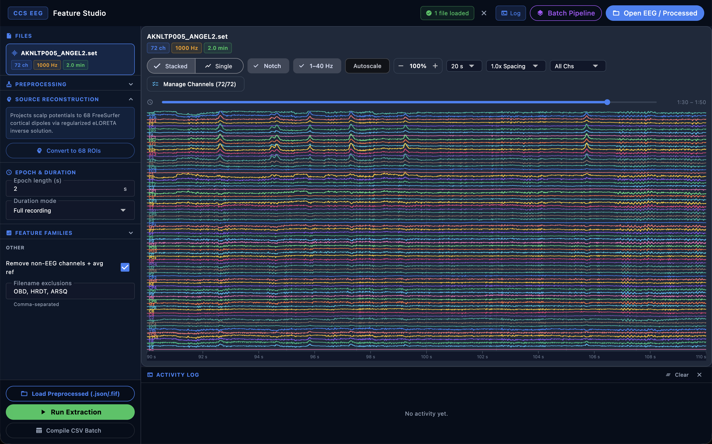
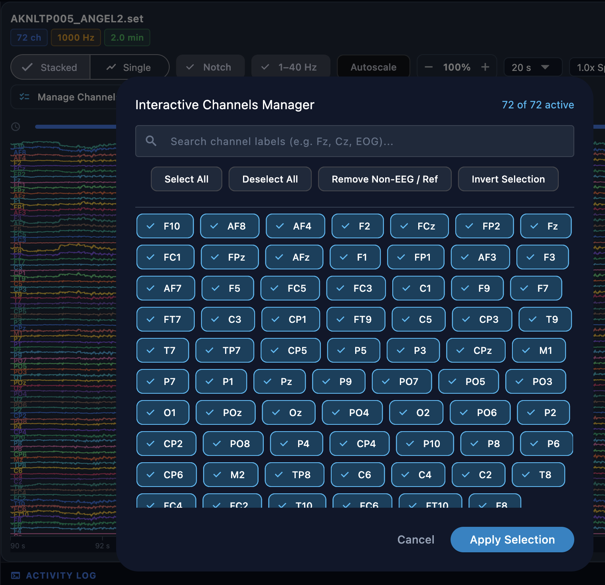
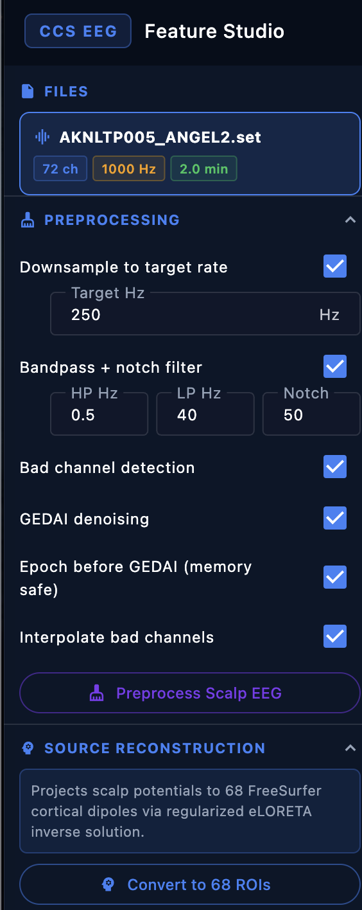
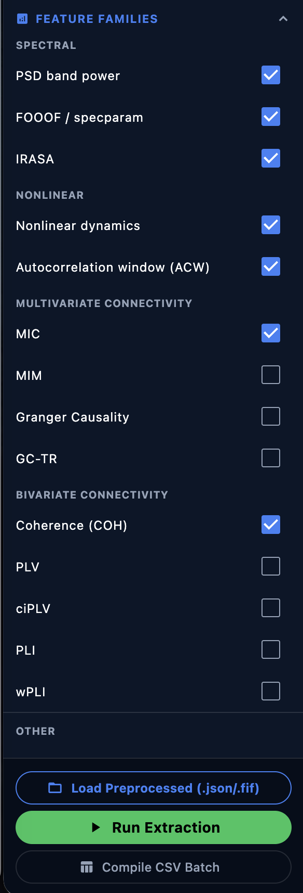
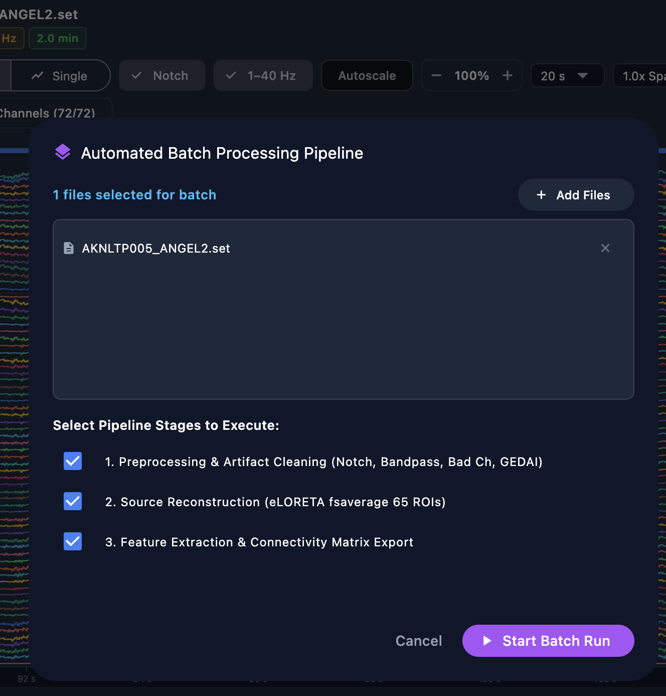

<p align="center">
  
</p>

<h1 align="center">CCS EEG Studio</h1>

<p align="center">
  <b>Native-speed EEG preprocessing, feature extraction, connectivity, statistics, and reporting</b>
</p>

<p align="center">
  A Research & Engineering Collaboration of<br>
  <b>Centre for Consciousness Studies (CCS)</b>, Department of Neurophysiology,<br>
  <b>National Institute of Mental Health and Neurosciences (NIMHANS)</b>, Bengaluru, India<br>
  🤝<br>
  <a href="https://axxonet.com/"><b>Axxonet</b></a>
</p>

<p align="center">
  <a href="https://github.com/arunsasidharan84/CCS_EEGStudio/releases/latest"></a>
  <a href="https://github.com/arunsasidharan84/CCS_EEGStudio/actions/workflows/build.yml"></a>
  <a href="https://github.com/arunsasidharan84/CCS_EEGStudio/releases"></a>
</p>

<p align="center">
  <b>Current version: 1.2.26</b> ·
  <a href="CHANGELOG.md">Detailed changelog</a> ·
  <a href="https://github.com/arunsasidharan84/CCS_EEGStudio/issues">Report a problem</a>
</p>

> **Important in 1.2.16:** corrected preprocessing resampling/event alignment, including 256→250 Hz. Version 1.2.15 used an incorrect rate ratio that can shift response-locked samples and reverse an ERP contrast. Regenerate affected outputs from their original inputs; an application update cannot repair already-misaligned epochs. See [the diagnosis, validation and recovery guidance](docs/erp_workbench.md#resampling-correction-and-existing-results). Individual-trial measurement CSV export is now optional and off by default; use `erp_measurements.csv` for conventional ERP condition averages.

### ERP analysis and interactive batch review — 1.2.15

The ERP workspace now supports single-recording and batch ERP CORE analysis for **MMN, N170, N2pc, N400, P3, LRP and ERN**. Import a folder, inspect proposed marker assignments, review task-specific windows/ROIs, and run to obtain waveforms, peaks/mean amplitudes/AUC, participant-level statistics, topographical inference and a compact PDF. Custom event classes and per-task settings are editable. Interactive ERP uses the active saved trial file and asks for condition groups; all multi-recording work is under Batch Workspace profiles for EEG, ERP and Microstates.

Optional native Rust analyses include multichannel rERP, sparse continuous FIR overlap correction, shrinkage-LDA decoding and temporal generalization. Metadata-driven group models accept condition or difference-wave measurements. The FIR model implements a defined linear subset of Unfold; complete toolbox parity is not claimed. A 14-recording ERP CORE pilot matched independently reconstructed MNE/NumPy trial counts and ROI waveforms.

**Recommended ERP workflow:**

1. Open a recording and choose locking events, named condition groups, trial limits and baseline. **Epoch Events** and Preprocess share the same protocol.
2. For already-cleaned data, choose **Epoch only (keep existing cleaning)**; otherwise review the cleaners and run **Clean + epoch**. Saved files distinguish `-epo` from `-epo_clean`.
3. Select saved A/B conditions, component, ROI and measurement window, then **Average & analyse ERP**. Trials are reused, not cut a second time.
4. For multiple recordings, use **Batch Workspace → ERP**. Open **Interactive batch review** to select participants or individual recordings, overlay differences, adjust the measurement window, inspect scalp maps and view equal-participant grand averages with ±1 SEM.
5. Label participant cohorts, select CSV parameters, and export or open group statistics. Exported measurements use unsmoothed waveforms. Save/load protocols to reuse event definitions and analysis settings.

**Interpretation:** negative-up is a display convention; component polarity selects a peak and never flips voltages. The difference is always B−A. Conventional ERN comparison is A=Correct, B=Incorrect. Additional cleaning can change an ERP that was already cleaned upstream. Existing files are not silently repaired or inverted. Live window changes update descriptive measurements/maps; inferential tests require a new group-statistics run. Older ERP results need re-averaging for arbitrary-window scalp maps.

**Additional native methods:** MNE, dSPM, sLORETA and LCMV inverse operators, imported fixed-orientation forward/atlas models, Gaussian-copula MI, within-epoch lagged-time transfer entropy, and configurable graph summaries. HCPex requires a compatible user-supplied atlas/forward model; atlas data are not bundled. See [source methods, graph definitions, estimator scope and references](docs/source_information_graph.md) and [event-preserving feature exports](docs/feature_event_markers.md).

See [ERP workflow, methods, references, numerical validation and limitations](docs/erp_workbench.md). Version 1.2.15 includes these workflows. Open **Updates** to download the release for your platform.

<p align="center">
  <a href="#-quick-download"><b>📥 Download App</b></a> &nbsp;•&nbsp;
  <a href="#about"><b>About</b></a> &nbsp;•&nbsp;
  <a href="#-features"><b>Features</b></a> &nbsp;•&nbsp;
  <a href="#-running--building-locally"><b>Build from Source</b></a> &nbsp;•&nbsp;
  <a href="CHANGELOG.md"><b>Release Notes</b></a> &nbsp;•&nbsp;
  <a href="https://github.com/arunsasidharan84/CCS_EEGStudio/issues"><b>Report Issue</b></a>
</p>

---

### 📥 Quick Download

Pre-built standalone desktop installers and application bundles are published through GitHub Releases:

| Platform | Package Type | Extracted App / Binary | Direct Download Link |
| :--- | :--- | :--- | :--- |
| **macOS** | Apple Silicon ZIP (macOS 12+) | **`CCS EEG Studio.app`** | [CCSEEGStudio-macos.zip](https://github.com/arunsasidharan84/CCS_EEGStudio/releases/latest/download/CCSEEGStudio-macos.zip) |
| **Windows** | 64-bit installer (Windows 10/11) | `CCSEEGStudio-Installer.exe` | [CCSEEGStudio-Installer.exe](https://github.com/arunsasidharan84/CCS_EEGStudio/releases/latest/download/CCSEEGStudio-Installer.exe) |
| **Linux (Debian / Ubuntu)** | amd64 DEB package | `ccseegstudio` | [CCSEEGStudio-linux-amd64.deb](https://github.com/arunsasidharan84/CCS_EEGStudio/releases/latest/download/CCSEEGStudio-linux-amd64.deb) |
| **Linux (RHEL / AlmaLinux)** | x86_64 RPM package | `ccseegstudio` | [CCSEEGStudio-linux-x86_64.rpm](https://github.com/arunsasidharan84/CCS_EEGStudio/releases/latest/download/CCSEEGStudio-linux-x86_64.rpm) |

> 📦 **All Releases & Checksums:** Every release includes [`SHA256SUMS.txt`](https://github.com/arunsasidharan84/CCS_EEGStudio/releases/latest/download/SHA256SUMS.txt) for cryptographic verification. View all packages on the **[GitHub Releases Page](https://github.com/arunsasidharan84/CCS_EEGStudio/releases/latest)**.  
> 🔄 **In-App Upgrades:** Once installed, choose **Updates** in the app's top bar to check, download, and apply the correct update package automatically.

#### 🍏 First-Time Launch for macOS Users (Gatekeeper Setup)

When you download and unzip **`CCSEEGStudio-macos.zip`**, macOS extracts **`CCS EEG Studio.app`** into your `~/Downloads` folder. Because development releases are ad-hoc signed, macOS Gatekeeper blocks opening them by default.

To enable the app, run the following in **Terminal**:

```sh
# 1. Clear Gatekeeper quarantine on the downloaded app:
xattr -rd com.apple.quarantine ~/Downloads/CCS\ EEG\ Studio.app

# 2. Move to Applications folder:
mv ~/Downloads/CCS\ EEG\ Studio.app /Applications/
```

> **Tip (Finder alternative):** In Finder, **Right-click (or Control-click)** `CCS EEG Studio.app` → select **Open** → click **Open** on the security confirmation prompt. You only need to do this once.

#### 🐧 Multi-User Linux Server Setup (AlmaLinux / RHEL / Ubuntu / Debian)

To install or update CCS EEG Studio across all current and future user accounts on an Enterprise Linux or Ubuntu/Debian multi-user server (with executable desktop shortcuts in `/serverdata/ccshome/*/Desktop`, `/etc/skel/Desktop/`, and the Applications menu):

```bash
# Automated multi-user installation:
curl -fsSL https://raw.githubusercontent.com/arunsasidharan84/CCS_EEGStudio/main/scripts/install_linux.sh | sudo bash
```

Administrators can update the shared installation with the command below. Standard users can instead use the no-sudo bootstrap/update described in [the per-user server guide](docs/server_and_plot_controls.md); that installs an independent user copy and leaves the shared package intact:
```bash
sudo update-ccs-eeg-studio
```

The updater fetches the current installer on each run. Downloads use a private temporary directory to avoid permission conflicts with packages left in shared `/tmp` by another user. If an older run failed with `curl: (23)` at `/tmp/CCSEEGStudio-linux-x86_64.rpm`, rerun the command above.


<p align="center">
  
</p>

---

## About

**CCS EEG Studio** turns research EEG recordings into reproducible, analysis-ready outputs without requiring Python or MATLAB on the end user's computer. A Flutter desktop interface orchestrates a native Rust engine for preprocessing, source projection, epoch-wise features, functional connectivity, ERP analysis, microstates, topographic statistics, plots, and PDF reports.

> The algorithms are ported from [`ccs_toolbox`](https://github.com/arunsasidharan84/ccs_toolbox) and continuously validated against Python reference implementations and MNE Connectivity.

### Why CCS EEG Studio?

| | Capability |
| :---: | :--- |
| ⚡ | Native Rust processing with parallel epoch dispatch via Rayon |
| 🧠 | Spectral, aperiodic, nonlinear, connectivity, ERP, source-space, and microstate analysis |
| 📊 | Channel-level CSVs, scalp maps, statistics, plots, and publication-ready PDF reports |
| 📁 | EDF/EDF+, EEGLAB SET/FDT, MNE FIF, FieldTrip MAT, BrainVision, and portable CCS EEG files |
| 〰️ | SleepStudio-style light waveform canvas with uniform traces and EEGLAB-style stitched epoch scrolling |
| 🧹 | Configurable GEDAI window/epoch size for continuous and memory-safe preprocessing |
| 🔁 | Single-recording exploration and unattended batch pipelines share one configuration |
| ⬆️ | Built-in update checker downloads and installs verified packages directly from GitHub Releases |

---

## New in 1.2.27: simpler saved-trial ERP analysis

Install using **Updates → Check for updates → Download and install**. Version 1.2.27 is distributed through GitHub Releases with package checksums for macOS, Windows and Linux.

The preprocessing panel groups **Signal preparation** and **Artifact cleaning**, with advanced protocols collapsed. **ASR on ICA fit copy** affects only decomposition training; **ASR on output** is a separate continuous-data cleaner. Progress shows elapsed time and ICA iterations, and completes after saving. Open **Processing history** on a recording to review completed steps and warnings.

For the tested Pallavi `Data_v2` example:

1. Open `Sakshi_task_post-epo_clean.edf` with its `.edf.ccsmeta` companion beside it. Existing trials are reused. The original file reports that ICA was skipped; inspect that warning before treating it as fully cleaned.
2. Go to **ERP Analysis**, select **P3**, and retain the actual saved groups: **Standard (280)**, **Pleasant (40)** and **Neurtral (40)**. Labels are preserved exactly. Edit groups or reorder conditions to choose the comparison reference; review the displayed difference direction.
3. Set **ROI Pz**, **measurement 300–600 ms**, and **baseline −200–0 ms**. The saved trial window is **−500–1200 ms**. Timing can be recovered from the recorded parent protocol when an older cleaned file omitted it.
4. Average and analyse, then review waveforms, topography and measurements. Save the protocol for reuse in Batch Workspace. One participant supports descriptive results; group inference requires additional participants.
5. Open `erp_results.ccserp` to resume results. Use `erp_measurements.csv` for condition-level summaries and `erp_report.pdf` for review. The CSV retains legacy A/B and B_minus_A aliases alongside named conditions: select either representation when preparing statistics to avoid duplicate observations. Trial-level exports are optional inputs for trial models, not participant-level ERP averages.

Open `.vhdr` for original continuous data, `-epo.edf` for saved trials, or `-epo_clean.edf` for cleaned saved trials. Companion `.ccsmeta` files hold timing, groups and history and are loaded automatically. Saving now normalizes recording extensions before the dialog, preventing `.edf.edf` accumulation. Existing files remain compatible.

Short-trial ICA uses within-trial reflected padding for blink filtering; this avoids the previous filter-length skip without joining neighboring trials. The long-trial detector retains its existing behavior. This boundary treatment is explicitly recorded and does not claim identical edge behavior to other toolboxes.

## What's new in 1.2.26: recording and ERP workflow

Update from the app using **Updates → Check for updates**, then download and install v1.2.26. The updater selects the package for your platform and verifies its checksum. Linux per-user installations update without sudo.

Choose **ERP Analysis** in the workflow selector. Use **ERP preparation order** above the sidebar to choose **Clean → Epoch** or **Epoch → Clean**. The sidebar and next-step buttons follow your choice, and saved protocols retain it. Cleaning saved trials preserves their event labels and boundaries. Internal GEDAI processing windows are cleaning blocks, not another event-epoching step. Standalone ASR requires continuous data.

The default clean-first route is:

1. **Open Recording** — open raw EEG, preprocessed continuous EEG, or saved epochs. Supported inputs include EDF/EDF+, BrainVision VHDR, SET, FIF, MAT, CCSEEG, ORB and XDF.
2. **Preprocess (optional)** — filter, re-reference and clean. In this ERP workflow, continuous input stays continuous; event trials are created in the next step. Skip cleaning when the input is already preprocessed.
3. **Epochs** — add named conditions and select their event codes, then set trial and baseline windows and save reusable trials. Raw-code selection, response rules, advanced matching and range limits are collapsed to keep the normal path compact. Protocols can be saved and reused. Existing saved epochs proceed directly to averaging.
4. **ERP Analysis** — use **Open preprocessed EEG / saved epochs…** to start directly from an existing recording, or use the current recording. Choose saved condition groups, ROI and measurement windows, then average and analyse. Continuous recordings link back to **Epochs**.

The header displays the installed app version. Loading runs in a cancellable worker: use **Cancel loading** to request a safe stop; the app remains responsive. XDF checks between chunks and sample blocks; other readers finish their current decoding phase before cancellation completes. Files are closed before the next load. XDF shows byte-reading progress; other readers show their current phase without inventing a percentage. The recording picker hides companion metadata, settings, protocols and analysis results and labels signal files by their likely next step. Open the signal file (`.edf`, `.fif`, `.ccseeg`, etc.), keeping its `.ccsmeta` companion beside it.

### XDF import

The native Dart importer requires no Python installation. It reads numeric signal streams and string/numeric irregular marker streams, offers a signal-stream selector, converts declared voltage units to µV, applies clock-offset interpolation, and puts markers on the corrected EEG timeline. Signal samples are linearly interpolated to a uniform grid spanning the corrected timestamps; the effective rate and selected stream are recorded in provenance. Unspecified units are treated as µV.

Clock resets, non-monotonic timestamps and gaps larger than five nominal sample intervals are rejected rather than silently moving ERP events. Repair or split such recordings with an XDF specialist tool before import. Compressed `.xdfz` is not supported. This is a baseline importer, not a claim of full pyxdf recovery/dejittering parity. See the [XDF format specification](https://github.com/sccn/xdf/wiki/Specifications) and [pyxdf](https://github.com/xdf-modules/pyxdf) for reference.

## What's new in 1.2.23

Click **New instance** in the top toolbar to open another independent app window on Linux, Windows or macOS. Each window can load different recordings and run its own analysis. Closing one window leaves the other processes running. Choose separate output folders for simultaneous jobs.

On macOS you can also run `open -n -a "CCS EEG Studio"`. On Linux or Windows, launch the installed executable again. Linux permits multiple instances under the same account; per-user updates preserve files needed by already running instances. For shared servers, set `RAYON_NUM_THREADS` before launch to control CPU use per process. See [server and instance guidance](docs/server_and_plot_controls.md).

This release also includes the administrator updater temporary-file permission fix and the ERP improvements listed below.

## What's new in 1.2.22

### Multi-condition ERP analysis, event group naming and peak accuracy

- **Arbitrary Conditions ($K \ge 2$)**: Configure and compare multiple named conditions (e.g. Standard, Oddball, Distracter, Novel) simultaneously in single-subject and batch ERP analysis, replacing previous two-condition limits.
- **Event Group Naming**: Condition names are automatically serialized and displayed throughout waveform plots, multi-channel grids, legends, summary tables, and exported CSV models (`Condition` column reflects the true event group).
- **Peak Latency Accuracy**: The peak latency calculation now employs interior turning-point detection and opposite-polarity deflection fallback, avoiding window endpoint boundary pinning.

### Batch individual ERP browsing gallery

- **Individual ERPs Gallery**: Dedicated batch results tab with live search/filter by Subject ID or assigned group. Participant cards display mini sparkline ERP waveforms, accepted trial counts, group affiliation badges, and peak measurements, with a one-click **Inspect →** button jumping directly into that participant's waveforms and channel grid.
- **Participant Stepper**: Added `[◀ Prev]` `Grand Average / Participant X of N` `[Next ▶]` stepper in the ERP results header for rapid cycling through individual recordings.

### Publication-friendly plots studio & group labeling

- **Publication Plots Studio**: Interactive studio providing journal-ready figures matching cognitive ERP literature (Cahn & Polich 2009):
  - **Fig 1**: Grand-averaged waveform grid across midline electrodes and conditions with group overlays, shaded SEM error bands, and N1/P2/P3a peak callouts.
  - **Fig 2**: Scalp topographic voltage maps grid (Groups $\times$ Conditions $\times$ Components) with scientific diverging colorbar and head outlines.
  - **Fig 3 & 5**: Interaction line plots of Component Mean Amplitude / Peak Latency across Electrodes and Conditions with SEM error bars.
- **Vector & High-Res Export**: Direct export to **W3C Vector SVG** (infinite resolution) and **300 DPI High-Resolution PNG**.
- **Participant Group Labeling**: Interactive `ErpGroupLabelDialog` to label participant cohorts directly from the UI after batch analysis, with automatic prefix guessing (e.g. `CTRL_` vs `MED_`), 50/50 split, manual assignment, and CSV export/import (`participant_groups.csv`).

### State-of-the-art statistics (eTFCE & LMM/GLM)

- **Electrode-Adjacency TFCE**: Integrated `compute_etfce` using Smith & Nichols (2009) and Mensen et al. (2013) parameters ($E=0.5, H=2.0$) with 10-20 spherical scalp coordinate neighborhood adjacency graphs and non-parametric subject permutation testing.
- **Direct Stats Integration**: One-click launch from the publication plots studio into Linear Mixed Models (LMM), Repeated-Measures ANOVA, and eTFCE statistics.

---

## What's new in 1.2.21

### Server updates without sudo and multiple instances

Every server account can install/update its own copy without changing the shared
system installation. Linux **Updates** prefers the portable `.tar.gz`, verifies
its checksum, installs into `$XDG_DATA_HOME/ccseegstudio/releases/` (default
`~/.local/share/ccseegstudio/releases/`) and switches the per-user launcher.
Existing instances retain their previous version directory and continue running.

For an older installation that only offers sudo updates, download and run the
[no-sudo bootstrap script](scripts/update_linux_nosudo.sh) once:

```bash
curl -fsSL https://raw.githubusercontent.com/arunsasidharan84/CCS_EEGStudio/main/scripts/update_linux_nosudo.sh -o /tmp/ccseeg-update.sh
bash /tmp/ccseeg-update.sh
```

Launch the user copy with `~/.local/bin/ccseegstudio` or the desktop launcher.
GTK and other system runtime dependencies must already be available. DEB/RPM
installers remain available for administrators. No shared installation is made
world-writable.

Use the **Open another independent instance** toolbar button for concurrent
analyses, with different output paths. On shared servers, for example,
`RAYON_NUM_THREADS=4 ~/.local/bin/ccseegstudio` bounds an instance to four CPU
workers. GPU numerical acceleration is not enabled yet; it requires a compatible
compute backend and validation for the server GPU/runtime. See [server and display
controls](docs/server_and_plot_controls.md).

### ERP axes, epoch duration and reference selection

**Plot axis limits** controls display time (ms) and voltage (µV), including ERP
batch review and electrode grids. Blank pairs use Auto; limits do not alter data
or measurement windows. Single-epoch view labels its actual duration and saved
zero-relative fractional times; stitched view restores the continuous time window.
Preprocessing now exposes **Output re-reference** directly: keep current/cleaned,
common average, or selected/linked reference electrodes.

### Included from 1.2.19

### BrainVision scaling correction

Float32 `.vhdr` recordings now apply the channel resolution in the header. The
previous Flutter loader ignored it, which made the Pallavi viewer/direct exports
about **20.48× too large** for a resolution of 0.0488281 µV. Native Rust processing
from the original BrainVision files already applied this calibration. Recreate
affected direct epoch-only/crop exports from the originals; old saved files are
not silently rescaled. V/mV/nV voltage units are converted consistently to µV.

### Faster loading and visible processing

Large BrainVision and portable recordings decode off the UI thread with typed
sample buffers and fewer temporary copies. Loading and preprocessing show activity
immediately, with **Stop processing** and ICA iteration feedback. Native Infomax
reuses activation buffers and release builds use thin LTO. Windows speedups have
not yet been measured; runtime still depends on channel count, duration and solver.

### Save recordings in EDF+, FIF, or CCSEEG

Open a processing **Settings** dialog and choose **Saved recording format (all
workflows)**. EDF+ is the default on fresh settings; an explicit saved choice is
retained. The preference applies across preprocessing, crop/subepoch, source outputs
and event epoching.

| Format / artifact | Filename example | Contents and use |
| --- | --- | --- |
| EDF+ | `subject-epo_clean.edf` + `subject-epo_clean.edf.ccsmeta` | Binary 16-bit signal plus exact application timing, trial labels and history |
| FIF | `subject-epo_clean.fif` + `subject-epo_clean.fif.ccsmeta` | Binary float32 raw/epochs plus application metadata |
| CCSEEG | `subject-epo_clean.ccseeg` | Native portable signal, embedded metadata/provenance; contents remain JSON |
| ERP protocol | `task.ccsprotocol` | Reusable epoching, condition and analysis settings |
| ERP results | `erp_results.ccserp` | Saved results that can be reopened in the ERP workbench |
| History / feature metadata | `.ccshistory`, `.ccspreparation`, `.ccsanalysis` | JSON-content companions with recognisable roles |

Keep each EDF/FIF signal with its `.ccsmeta` companion to restore exact epochs,
markers, original event anchors and protocols. EDF quantizes to 16-bit; FIF retains
floating-point amplitudes. These exports do not require Python. Legacy signal JSON,
`.ccseeg.json`, protocol/result JSON and old history companions remain readable.

**Settings → Organise legacy output filenames** previews safe extension renames,
refuses collisions and writes a migration manifest. Signal samples are not
re-encoded; raw vendor inputs and unknown JSON files are left alone. New output
names strip repeated extensions such as `.ccseeg.ccseeg`.

### Epoching, response rules and ERP review

1. Choose **Saved data structure**: Continuous, Event-based trials, or Fixed-length
   windows. Event trials use their own locking/baseline window; fixed windows can
   use overlap.
2. For ERP trials, label marker groups and optionally set response inclusion.
   Choose correct/incorrect feedback markers, or map stimulus markers to expected
   buttons (for example `S20 = R1`, `S30 = R2`). All, correct, incorrect and missed
   trials are selectable. Rules persist in reusable protocols.
3. Inspect higher-contrast event lines and the separate event-label lane. Method
   parameter sections are collapsible; ICA/ICLabel has its own parameter action.
4. Average saved groups and review selectable electrode grids, participant-weighted
   waveforms, measurement windows and clear time-zero/voltage-zero references.

ICA supports existing trials with one shared decomposition. High-pass/blink
processing and the internal ASR training-copy adapter respect trial boundaries;
training rejection does not delete samples from saved trials. Standalone ASR and
muscle correction remain continuous-data operations. With continuous input,
ICA/ASR runs before event extraction. ASR **Reject** cannot be combined with event
extraction because deleted samples would invalidate timing; use **Correct**.

The independent Pallavi review found no progressive resampling drift and confirmed
all 483 saved Pz epochs against their continuous source. Oscillations were also
present in independently filtered raw averages. This is a timing validation, not a
claim that the ERP is artifact-free. See the [detailed audit and migration guide](docs/pallavi_erp_review.md)
and [format/performance validation](docs/pallavi_performance_and_files.md), including
method references and limitations.

> 📜 See the complete **[CHANGELOG.md](CHANGELOG.md)** for detailed feature notes across all releases.

---

## 🧭 Two Workflow Modes

The app provides two dedicated operating modes sharing a unified configuration engine:

| | **Single Recording** | **Batch Pipeline** |
| :--- | :--- | :--- |
| **Input** | Exactly one file | A queue of many files or recursive directory |
| **Waveform viewer** | ✅ Yes, real-time inspection | ❌ No, optimized for throughput |
| **Run granularity** | One button per stage — stop, inspect, continue | Per stage, or all stages in sequence |
| **Channel types** | Auto-detected, reviewable and overridable per channel | Auto-detected per file |
| **Outputs** | One CSV + PDF + plots for that recording | One CSV/PDF/plot folder **per file**, plus pooled CSV and group overlay plot |
| **Use case** | Exploring data, tuning cleaning settings, dialling in parameters | Unattended production and cohort processing |

Both modes bind to the **same** analysis configuration object. Every option (preprocessing, source localisation, all fourteen feature families, epoching, duration mode, plotting) appears in both places, and a setting tuned on one recording carries directly over to the batch queue.

### Pipeline Stages
1. **Preprocessing** — downsampling, zero-phase filtering, bad-channel detection, GEDAI artifact removal, interpolation.
2. **Source Space** *(optional)* — MNE, dSPM, sLORETA, or LCMV projection using bundled fsaverage/Desikan–Killiany or an imported forward/atlas model.
3. **Feature Extraction** — epoching, multi-domain feature families, CSV outputs.
4. **Plots & Reports** — topoplots, time-series plots, group overlays, publication-grade PDF report.

### Recording preparation and advanced settings

Use **Crop / subepoch and save** before analysis to select marker or time bounds,
then optionally create sliding windows with overlap. Already epoched recordings
support within-trial crops or complete-trial selection; subwindows never cross
parent boundaries. Save the prepared recording for later reuse. Settings icons
expose output/feature references, filter design, interpolation, source SNR/regions,
Welch estimation, custom frequency bands, nonlinear parameters, and GC lags.
File selectors support `*`, `?`, and semicolon-separated filename patterns.

Plots support manual session ordering and line colors. Reopening saved cleaned
recordings recovers preprocessing/source history and adjacent analysis outputs.
See [workflow details and analysis conventions](docs/workflow_improvements.md).

### Preprocessed dataset batches

**Version 1.2.13** fixes continuous FieldTrip files appearing as one saved epoch
and failing extraction. A one-cell continuous FieldTrip trial now remains
continuous; full-resolution engine samples are kept separate from waveform previews.

To test a subset: enable **Already preprocessed: start with features**, enter 10
under **Folder import: first N subjects**, then import the folder in the feature
stage. Set the epoch length and overlap; enable **Subepoch existing trials** only
when existing parent trials should be subdivided. Saved preprocessing overlap is
formed after cleaning so each source sample is cleaned once. Stage 4 opens the
metadata/model workbench after the feature/plot stages when requested.

Use **Infer metadata from filenames…** to preview BIDS Subject/Session/Task/Run/
Acquisition fields or a custom named-group pattern, then save the reviewed CSV.
Unknown fields stay blank. Choose the subject ID, factors and outcomes before
running group inference. Two-second fE:I remains available for bands/windows that
pass its validity checks; the window warning is advisory.


Batch Workspace can start directly with features for already-cleaned data, limit
folder imports by subject count, create overlapping analysis windows and hand the
successful outputs to Stage 4 group statistics. Filename metadata inference has a
review/save preview and custom named-group patterns. See the
[psiconnect workflow and pilot checks](docs/psiconnect_batch_workflow.md).

### Easier results selection

Plotting has a results-folder button, a bounded searchable recording list and
bulk comparison controls. Group Statistics accepts a folder or multiple feature
CSVs, aligns pooled columns, normalizes numeric imports, and shows a clear run
control after inspection. The Continuous EEG sidebar includes Group Statistics.
See the [results workflow](docs/intuitive_results_workflow.md) for channel-scope
choices, where reports are saved, and the separately labeled short-epoch
### Adjusting Plots and Reducing Lateral Spread

When analyzing recordings with long durations (e.g. 60–90 minute sessions) or many sessions, plotting topomaps for every 2-minute window can create a very wide horizontal aspect ratio (e.g., 50+ inches). You can easily adjust and compress the lateral spread:

1. **Width Presets (`Topo width`)**: Under **TOPOMAPS** in the sidebar, click the **`Compact (0.35")`** or **`Medium (0.5")`** preset pills (or enter a custom value such as `0.3` and press Enter). This instantly scales down the width of every topomap column without having to re-run the permutation statistics.
2. **Window Duration (`Window`)**: Under **WINDOWS & LINE PLOT**, increase **`Window`** from `2.0 min` to `5.0 min` or `10.0 min`. This decreases the number of topomap columns by 2.5× to 5×, yielding a balanced, publication-ready figure width.
3. **Fit View in Canvas**: Click **`Fit`** in the top toolbar to automatically fit the entire figure width into the current window, eliminating horizontal scrolling.
4. **Stacked Multi-Group Display**: When comparing multiple days or recordings, use **`Add group`** to load them as separate stacked plot groups rather than stringing all sessions into a single wide plot.

### Metadata and group statistics

Open **Group Statistics** from the batch workspace or Full Pipeline. Join feature
CSVs to metadata CSV/XLSX and select subject ID, group, optional within-subject
factor, covariates, and outcomes. The SleepStudio-derived workbench provides LMM
with subject random intercepts and GLM with robust/clustered covariance,
model-adjusted contrasts, and multiple-comparison correction. Epochs are aggregated
per recording/channel/condition before modeling; multiple subjects are required.

This optional feature needs a local Python environment:

```sh
python3 -m venv .venv-group-stats
.venv-group-stats/bin/python -m pip install -r assets/requirements-group-stats.txt
# Launch the app from a shell with this interpreter configured:
export CCS_EEG_PYTHON="$PWD/.venv-group-stats/bin/python"
```

On Windows, use the environment's `Scripts/python.exe` and set `CCS_EEG_PYTHON`
accordingly. The requirements file includes optional XLSX and Word/PDF dependencies.
No external LLM service is used. Failed mixed models are reported without a silent
OLS fallback. See [1.2.10 release notes](CHANGELOG.md#1210) for compatibility details.

### Channel Types
Non-EEG channels are **auto-detected from their labels** on load — ECG, EOG, EMG, GSR, respiration, PPG, motion/accelerometer, references and trigger channels are each recognized as their own kind. The **Channel Types** panel in Single Recording mode lists every channel with its detected kind and lets you override any of them; whatever you set is exactly what reaches the engine.

---

## 🔬 Features

### Recording Formats Supported
- **EDF / EDF+** — Standard European Data Format, including Annotations (TAL) channels.
- **EEGLAB SET / FDT** — Standalone embedded `.set` data or `.set` plus external float32 `.fdt`.
- **FieldTrip MAT** — MATLAB v5 `ftData` structs with continuous numeric trials or cell-array trials.
- **BrainVision VHDR / EEG / VMRK** — BrainProducts binary and ASCII formats.
- **MNE FIF** — Continuous raw and epoched MNE-Python FIF recordings.
- **CCS EEG JSON** — Portable preprocessed or epoched recordings produced by the app.

### Preprocessing
- **Re-referencing**: Common-average reference (CAR) or arbitrary reference channel subtraction.
- **Channel exclusion**: Auto-detection of non-EEG channels (ECG, EOG, EMG, GSR, respiration, PPG, motion, references, triggers), reviewable and overridable per channel.
- **Duration modes**: Full recording, fixed interval (start/end seconds), fixed bin size, or the *middle two minutes* mode used by the CCS pipeline.
- **Accepted / rejected interval masks**: Restrict extraction to annotated clean segments.
- **GEDAI windows**: Explicitly configure the window/epoch size used for GEDAI, with memory-safe pre-epoching for long recordings.
- **Stimulus epochs**: Cut event-locked trials after filtering and before GEDAI, retain marker labels and epoch timing, and optionally apply baseline correction.

### ICA, ASR and muscle cleaning

Preprocess offers opt-in **Infomax/runica or Picard ICA**, blink and second-stage
ICLabel removal, **ASR Correct/Reject** with selectable variants, and **BSS-CCA,
iCanClean or wavelet ICA**. Parameters are exposed through the settings icon.
The processing order is bad-channel detection → ICA → muscle cleaner → ASR →
fixed-window epoching/GEDAI → interpolation → output reference/source projection.
ICA requires at least 8 good located 10-05 channels and 20 seconds of continuous
input. These cleaners skip already epoched data, including stimulus trials cut
before this stage. ASR Reject changes the timeline; Correct preserves its length.

Standard/Riemannian ASR, runica/Picard, ICLabel, BSS-CCA, iCanClean and wICA have
specific numerical reference checks. Adaptive ASR is our EMA design; E-ASR and
mode-based ASR combinations are experimental adaptations without original-code
parity. They are not interchangeable implementations of every similarly named
published algorithm. See [method references and scoped validation](docs/methods_and_validation.md)
for parameter conventions, evidence and limits.

### ERP Analysis
- Define conditions from marker chips or regular expressions.
- Plot condition means ± SEM and test temporal clusters by permutation.
- Compute component-window Welch tests, Cohen's d, and bootstrap confidence intervals.
- Map both a selected latency and a time-window average over the scalp for condition A, condition B, B−A, and Welch t.
- Mark electrodes passing Benjamini–Hochberg FDR correction.

### EEG Microstates
- Four- to eight-state solutions with canonical A–G template assignment.
- GFP, occurrence, duration, coverage, GEV, spatial correlation, sequence complexity, entropy production, and transition summaries.
- Synchronized sequence, waveform, and state-similarity exploration with one absolute-time axis.

### Spectral Analysis
- **Relative Welch / Hamming PSD** across 7 frequency bands:
  - Delta (1–4 Hz), Theta (4–8 Hz), ThetaAlpha (6–10 Hz), Alpha (8–12 Hz), Beta1 (12–18 Hz), Beta2 (18–30 Hz), Gamma1 (30–40 Hz).
- **FOOOF** (Fitting Oscillations & One-Over-F): Native Rust Levenberg-Marquardt implementation — isolates true oscillatory peaks from the aperiodic 1/f slope.
- **IRASA** (Irregularly Resampled Auto-Spectral Analysis): Separates fractal and oscillatory PSD components using geometric resampling.

### Nonlinear Metrics
Eight epoch-wise nonlinear complexity and entropy metrics per channel:
- Sample Entropy (SampEn), Approximate Entropy (ApEn), Hurst Exponent, Lempel-Ziv Complexity, Autocorrelation Window (ACW), Detrended Fluctuation Analysis (DFA) exponent, Higuchi Fractal Dimension, Katz Fractal Dimension.

### Compact reports and DFA/fE:I context

Analysis PDFs now default to a compact summary, one representative waveform page,
scalp maps with fitted head outlines/contours, selected time courses and key statistics.
Detailed reports remain selectable. Waveform scaling accounts for decimated previews
and keeps shown peaks inside their rows on shared raw/cleaned scales.

DFA/fE:I can use a separate source context (UI default 60 s; zero means epoch only)
without enlarging PSD or other feature epochs. Context cannot cross saved trial
boundaries. Its actual bounds are written to CSV metadata. Missing DFA no longer
passes the fE:I qualification gate. See the [report/context guide](docs/report_and_dfa_context.md)
for method references, the five-second-data explanation and scoped validation.

### Feature windows and output defaults

Before extraction, the app warns about short selected-feature windows: DFA/fE:I
below the practical 60-second full-band recommendation, FOOOF/IRASA below one
second, a Welch window longer than the epoch, or too few samples for the GC lag
count. Saved parent-epoch lengths take precedence over the extraction control.
Choose **Change settings** or explicitly continue with limited/missing results;
batch runs ask once for each distinct warning. The app never merges trials silently.

The 60-second DFA/fE:I recommendation accommodates the implementation's long
fit scales; it is not a universal paper-prescribed minimum or a guarantee that
fE:I passes its validity criteria. For two-second windows, lower-band estimates
may be missing even though Gamma1 DFA is available. See the method references
below and the [window/output guide](docs/output_files.md).

Defaults now retain per-recording CSVs, analysis PDFs, and combined plots PDFs
with statistics tables. A pooled CSV and individual high-resolution PNGs are
optional exports. Disabling the plots PDF generates PNGs instead. New summary
reports use `.analysis_report.pdf`. Cleaned recordings and provenance companions
remain; existing output files are not automatically deleted.

### Band-limited DFA and fE:I

The optional DFA/fE:I family estimates amplitude-envelope scaling and a functional
excitation/inhibition index in each selected band. It follows Hardstone et al.
(2012) and Bruining et al. (2020), with windows clamped to available samples and
missing values for bands that cannot fit. Short epochs do not establish long-range
correlations at the literature's timescales. Method papers and implementation
conventions are listed below and in the [validation guide](docs/methods_and_validation.md).

### Connectivity Analysis
Nine connectivity measures computed via Morlet wavelet cross-spectra matching `mne-connectivity 0.8`:
- **MIC** (Maximized Imaginary Coherence), **MIM** (Multivariate Interaction Measure), **GC** (Granger Causality 25-lag VAR), **GC-TR** (Time-reversed GC), **GC − GC-TR contrast**, **Coherence**, **PLV**, **ciPLV**, **PLI**, **wPLI**.

### Outputs & Plot Layout

See the [output file guide](docs/output_files.md) for compact defaults, report names,
provenance companions, optional exports and short-window warnings.

- **Per-file CSV export**: `<recording>.features.csv` for every input, with one row per (epoch, channel, bin) and all enabled feature columns.
- **Optional combined CSV export**: `Batch_features.csv` pooling every recording with provenance metadata (`subjid`, `sessn`, `condn`).
- **Publication-grade PDF reports & Scalp Maps**: High-resolution vector visualizations and executive summaries.

---

### Time-aligned feature annotations

Feature CSVs now retain time-aligned annotations in `event_markers`; feature line plots display event labels and duration shading, including exports made with overlapping epochs. See [event marker format and timeline support](docs/feature_event_markers.md).

### Source, information connectivity, and graphs

Source settings now select **MNE, dSPM, sLORETA, or LCMV**, with a bundled fsaverage model or an imported fixed-orientation forward/atlas model. HCPex grid-mapping tooling supports compatible supplied volumetric models. The old “eLORETA” label described a minimum-norm implementation and has been corrected.

Features add **GCMI**, **within-epoch temporal TE**, and **pair / graph / combined exports** for information and selected spectral connectivity. Graph summaries work on electrode or ROI inputs. See [methods, reference tests, atlas import, and supported parity scope](docs/source_information_graph.md) before interpreting these measures.

### ERP preparation and protocol reuse

**Epoch Events** and Preprocess share event groups, trial windows and baseline settings. Direct epoching saves `-epo.ccseeg.json`; preprocessing saves `-epo_clean.ccseeg.json` when the output contains trials. Continue with **Next: average and analyse saved trials**, select saved A/B conditions, review the component/ROI/window, then **Average & analyse ERP**. Original and processed recordings remain available when switching.

Use **Save protocol / Load protocol** to reuse epoching and averaging settings interactively or in the ERP Batch Workspace. Hover over the protocol help icon for the sequence. Review event/group matches on each dataset. See the [ERP workflow and protocol guide](docs/erp_workbench.md#reusable-epoching-and-averaging-protocols).

### Interactive ERP batch comparisons

After averaging, open **Interactive batch review** to search/select participants, inspect individual recordings or participant averages, overlay differences, and view equal-participant grand averages with ±1 SEM shading. Adjust measurement windows to update descriptive measurements and scalp maps live. Optional smoothing affects display only. Label participant cohorts and export selected ERP metrics to CSV or open group statistics. See the [review guide](docs/erp_workbench.md#interactive-batch-review-smoothing-and-cohort-labels).

For already-cleaned recordings, **Epoch only (keep existing cleaning)** preserves the supplied signal while preparing trials. A/B subtraction and negative-up display are labelled explicitly; unexpected ERP polarity is not automatically inverted.

## 🖥️ Application Screenshots

| Main Workspace | Channel Selection & Overrides |
| :---: | :---: |
|  |  |

| Preprocessing Configuration | Feature Extraction Families |
| :---: | :---: |
|  |  |

| Batch Analysis Pipeline |
| :---: |
|  |

---

## ⚡ Architecture

CCS EEG Studio uses a decoupled Flutter + Rust architecture:

1. **Flutter UI**: Provides recording navigation, channel selection, parameter tuning, progress visualization, and report generation.
2. **Rust Engine (`ccs-eeg-engine`)**: A standalone CLI binary launched as a subprocess via structured JSON job files:
   - Parallel epoch computation via **Rayon** multi-threading.
   - Spectral analysis (Welch PSD, Morlet wavelets, coherence, PLV) via **rustfft**.
   - Linear algebra for GEDAI and source localization via **nalgebra**.
   - Native implementations of FOOOF, IRASA, and nonlinear metrics.
3. **Dart Analysis Layer**: ERP statistics, permutation clustering, topographic interpolation, and PDF reporting in background isolates.
4. **Core analysis**: EEG preprocessing, extraction, ERP, microstates, and plotting run without Python, MATLAB, or R. The optional group-statistics workbench uses a local Python environment.

```
CCS_EEGStudio/
├── lib/                        # Flutter front-end
│   ├── main.dart               # App entry point
│   └── src/
│       ├── app.dart            # Root widget, navigation, theme
│       ├── eeg_viewer.dart     # Multi-channel EEG waveform preview
│       ├── extraction_service.dart  # Rust engine subprocess driver
│       ├── models.dart         # Shared data models (Recording, Options, Row)
│       ├── edf_loader.dart     # EDF/EDF+ file parser
│       ├── fif_loader.dart     # MNE FIF format parser
│       ├── fieldtrip_mat_loader.dart # FieldTrip MAT integration
│       ├── recording_loader.dart    # Unified loader dispatcher
│       ├── set_loader.dart     # EEGLAB SET/FDT format parser
│       ├── update_checker.dart # GitHub release updater
│       └── vhdr_loader.dart    # BrainVision VHDR/EEG/VMRK parser
├── bridge/                     # Rust computation engine
│   ├── Cargo.toml              # Rust package manifest
│   └── src/
│       ├── lib.rs              # Shared types, band definitions, module declarations
│       ├── main.rs             # Job dispatch and output writing
│       ├── fieldtrip_loader.rs # FieldTrip structs and trial conversion
│       ├── mat_v5.rs           # MATLAB v5 structs, cells, chars, numerics
│       ├── mne_fif.rs          # Raw + epoched MNE FIF loading
│       ├── microstates.rs      # Microstate analysis
│       └── stats.rs            # Statistical utilities
├── scripts/                    # Build & packaging helper scripts
├── test/                       # Flutter unit and integration tests
├── parity_test/                # Python vs Rust numerical parity fixtures
└── screenshots/                # Application documentation screenshots
```

---

## ✅ Scientific Validation

The Rust engine is continuously verified against Python reference implementations (`ccstools.eegfeatures`, MNE-Python, and `mne-connectivity`):
* PSD relative band powers, IRASA oscillatory powers, nonlinear metrics, ACW, and bivariate connectivity agree to floating-point precision on reference datasets.
* ERP waveforms and permutation cluster statistics are regression-tested against reference pipelines.
* Topographic scalp interpolation and FDR significance tests have dedicated synthetic and empirical test suites.

See [`scripts/compare_parity.py`](scripts/compare_parity.py) and [`scripts/run_parity_test.sh`](scripts/run_parity_test.sh) for instructions on running parity validation suites.

---

## 📚 Method references

| App method | Paper or original implementation | Studio convention |
| :--- | :--- | :--- |
| Infomax ICA / runica | Bell & Sejnowski (1995), [doi:10.1162/neco.1995.7.6.1129](https://doi.org/10.1162/neco.1995.7.6.1129); [EEGLAB source](https://github.com/sccn/eeglab) | Native runica/pop_runica port; fixed seed; two-stage CCS component selection. |
| Picard | Ablin, Cardoso & Gramfort (2018), [doi:10.1109/TSP.2018.2844203](https://doi.org/10.1109/TSP.2018.2844203); [original code](https://github.com/mind-inria/picard) | Port of python-picard 0.8. |
| ICLabel | Pion-Tonachini, Kreutz-Delgado & Makeig (2019), [doi:10.1016/j.neuroimage.2019.05.026](https://doi.org/10.1016/j.neuroimage.2019.05.026); [classifier source](https://github.com/sccn/ICLabel) | Default network; dynamic class thresholds; recognized scalp positions required. |
| ASR | [EEGLAB clean_rawdata documentation](https://eeglab.org/plugins/clean_rawdata/); [reference ASR source](https://github.com/sccn/clean_rawdata/blob/master/readme-asr.txt) | Native calibration/reconstruction/window rejection; Studio uses its own channel detector and 1 Hz fitting copy. |
| Riemannian ASR | Blum et al. (2019), [doi:10.3389/fnhum.2019.00141](https://doi.org/10.3389/fnhum.2019.00141) | EEGLAB Riemannian port; 30-second Studio processing blocks. |
| BSS-CCA | De Clercq et al. (2006), [doi:10.1109/TBME.2006.879459](https://doi.org/10.1109/TBME.2006.879459); [mne-denoise method](https://mne.tools/mne-denoise/dev/bss_cca.html) | Lagged-signal CCA; configurable component count or correlation threshold. |
| iCanClean | Downey & Ferris, [arXiv:2201.11798](https://arxiv.org/abs/2201.11798); [reference estimator](https://mne.tools/mne-denoise/stable/generated/mne_denoise.icanclean.ICanClean.html) | Pseudo-reference from a zero-phase fourth-order Butterworth band-stop filter. |
| wICA | Gabard-Durnam et al. (2018), [doi:10.3389/fnins.2018.00097](https://doi.org/10.3389/fnins.2018.00097); [HAPPE source](https://github.com/lcnhappe/happe) | Extended runica, coif5 SWT, ddencmp soft threshold; default 5 levels. |
| GEDAI | [GEDAI author implementation](https://github.com/Marco-Congedo/Gedai); [method tutorial](https://neuroimage.usc.edu/brainstorm/Tutorials/Gedai) | CCS port with standard leadfield covariance; explicitly warns on identity fallback. |
| Amplitude-envelope DFA | Hardstone et al. (2012), [doi:10.3389/fphys.2012.00450](https://doi.org/10.3389/fphys.2012.00450) | Band-specific fit scales; insufficient samples yield missing values. |
| fE:I | Bruining et al. (2020), [doi:10.1038/s41598-020-65500-4](https://doi.org/10.1038/s41598-020-65500-4) | Native CCS Python-method port; short-window adaptations are identified in the guide. |
| FOOOF / spectral parameterization | Donoghue et al. (2020), [doi:10.1038/s41593-020-00744-x](https://doi.org/10.1038/s41593-020-00744-x) | Native fit, configurable peaks; 1–40 Hz fitting range. |
| IRASA | Wen & Liu (2016), [original article](https://pmc.ncbi.nlm.nih.gov/articles/PMC4706469/) | Native resampling/spectral separation; configurable factors, 1–40 Hz fit range. |
| Connectivity / GC / GC-TR | [MNE-Connectivity spectral connectivity API](https://mne.tools/mne-connectivity/stable/generated/mne_connectivity.spectral_connectivity_epochs.html) | Morlet grid 4–40 Hz; native GC/GC-TR fits and their separately named difference. |

The [method and validation guide](docs/methods_and_validation.md) distinguishes
paper references, source ports, upstream numerical checks and release regression
tests. A numerical match on selected fixtures is not a claim of universal artifact
removal accuracy. Adaptive/embedding/mode-based ASR limits are documented there.

## ⌨️ Keyboard Shortcuts

| Shortcut | Action |
| :--- | :--- |
| `Ctrl+O` | Open a recording file |
| `Ctrl+E` | Start extraction with current settings |
| `Ctrl+S` | Save / export results CSV |
| `Ctrl+,` | Open settings / configuration panel |
| `Escape` | Cancel running extraction |

---

## 🚀 Running & Building Locally

### Prerequisites
* [Flutter SDK](https://docs.flutter.dev/get-started/install) (stable channel)
* [Rust Toolchain](https://www.rust-lang.org/tools/install) (`cargo` and `rustc`)
* For Windows installer: [Inno Setup](https://jrsoftware.org/isinfo.php) (`iscc` compiler)

### 1. Build the Rust Engine
Compile the native `ccs-eeg-engine` binary:
```sh
cd bridge
cargo build --release
cd ..
```

### 2. Run the App in Development Mode
```sh
# Install Flutter dependencies
flutter pub get

# Run on macOS
flutter run -d macos

# Run on Windows
flutter run -d windows

# Run on Linux
flutter run -d linux
```

### 3. Package Production Release
```sh
# macOS (.app bundle)
./scripts/build_macos.sh

# Windows (.exe Installer via Inno Setup)
flutter build windows --release
copy bridge\target\release\ccs-eeg-engine.exe build\windows\x64\runner\Release\
iscc windows\installer.iss

# Linux Debian/Ubuntu (.deb)
flutter build linux --release
cp bridge/target/release/ccs-eeg-engine build/linux/x64/release/bundle/
bash scripts/package_linux_deb.sh build/linux/x64/release/bundle dist/CCSEEGStudio-linux-amd64.deb

# Linux RHEL/AlmaLinux (.rpm)
flutter build linux --release
cp bridge/target/release/ccs-eeg-engine build/linux/x64/release/bundle/
bash scripts/package_linux_rpm.sh build/linux/x64/release/bundle dist/CCSEEGStudio-linux-x86_64.rpm
```

### macOS Gatekeeper
If macOS blocks an ad-hoc-signed build after extraction, run:
```sh
xattr -rd com.apple.quarantine ~/Downloads/CCS\ EEG\ Studio.app
```

---

## 🧪 Running Tests

```sh
# Rust Engine Tests
cd bridge && cargo test && cd ..

# Flutter Analyzer & Tests
flutter analyze
flutter test

# Python vs Rust Parity Tests
bash scripts/run_parity_test.sh /path/to/recording.set /path/to/reference_output.csv
```

---

## 🤝 Research Collaboration & Acknowledgments

**CCS EEG Studio** is developed as a joint research and neurotechnology engineering collaboration by:

* **Centre for Consciousness Studies (CCS)**  
  *Department of Neurophysiology*,  
  **National Institute of Mental Health and Neurosciences (NIMHANS)**, Bengaluru, India.  
  *Pioneering neurophysiology research into consciousness, cognitive states, meditation, and computational EEG analytics.*

* **Axxonet** ([https://axxonet.com/](https://axxonet.com/))  
  *Pioneering medical technology, EEG & neurophysiology instrumentation, and cognitive research solutions.*

---

## 🔗 Related Repositories

| Repository | Description |
| :--- | :--- |
| [CCS Sleep Studio](https://github.com/arunsasidharan84/CCS_SleepStudio) | Sleep EEG visualization, manual staging, 9 automated AI models, and AnalyseNidra quantitative reports |
| [CCS Mobile Studio](https://github.com/arunsasidharan84/CCS_MobileStudio) | Mobile/desktop neurophysiology acquisition, stimulation, ANGEL ERP, and cognitive experiments |
| [CCS PPG Studio](https://github.com/arunsasidharan84/CCS_PPGStudio) | Clinical and research photoplethysmography analytics, gapless quality ribbon, and HRV dynamics |

---

## 📄 License

Proprietary — Centre for Consciousness Studies, NIMHANS, Bengaluru, India. All rights reserved.

### Upcoming: large recordings and clearer ERP/file workflows

The unpublished working tree adds worker-based loading/display filtering, visible progress and cancellation, response-correctness rules, electrode panel grids and clearer zero references. New native saves use `.ccseeg` while legacy JSON recordings remain readable; the contents are still JSON, without compression. See [performance measurements, file-format trade-offs and usage](docs/pallavi_performance_and_files.md).

The saved-recording format is configurable from processing **Settings → Saved recording format (all workflows)**: CCSEEG, FIF, or EDF+. EDF/FIF exports include a matching `.ccsmeta` companion containing JSON metadata; keep the pair together. This preference applies to preprocessing, source/batch outputs and crop/event-epoch saves. FIF preserves floating-point samples; EDF+ uses 16-bit scaling and records its quantization in the companion.

The preprocessing panel now uses one **Saved data structure** selector (continuous,
event trials, or fixed windows), with collapsible method parameter sections.
Response rules support stimulus-specific expected buttons and missed responses.
ICA can operate across saved epochs while respecting trial boundaries; standalone
ASR remains a continuous-data step. **EDF+ is the fresh-settings default**.
Legacy file names can be reviewed and renamed from **Settings → Organise legacy
output filenames**; recordings, protocols, results, and histories have distinct
extensions. See the [Pallavi ERP review and file migration guide](docs/pallavi_erp_review.md)
for validation findings, limitations, and method references.
